# Synergy Expansion — Numerical Example Replication

Python replication of the numerical example in:

> F. Tessari, A. M. West Jr., N. Hogan, "Explaining human motor coordination via the synergy expansion hypothesis," *PNAS* 122, e2501705122 (2025). https://doi.org/10.1073/pnas.2501705122

## Context

The human body has far more muscles and joints than any single task requires, so the same movement or force can be produced in infinitely many ways. How the nervous system chooses among them is Bernstein's degrees-of-freedom problem. A classic answer is that it does not control each muscle independently, but a small number of *synergies*: groups of muscles activated together.

The paper proposes the *synergy expansion hypothesis*, built on three propositions:

- **Mechanical:** because the body is redundant, the number of possible synergies is not limited by the number of muscles or joints.
- **Developmental:** humans start from crude, highly coordinated patterns (primordial synergies) and, through learning and development, expand to new and more specialized synergies, which add to the old ones instead of replacing them.
- **Behavioral:** learned synergies are stored and recalled when needed.

The numerical example makes the first two propositions concrete. A planar 3-link arm (upper arm, forearm, hand) actuated by 10 muscles must produce a given force at the hand in a fixed posture.

<p align="center">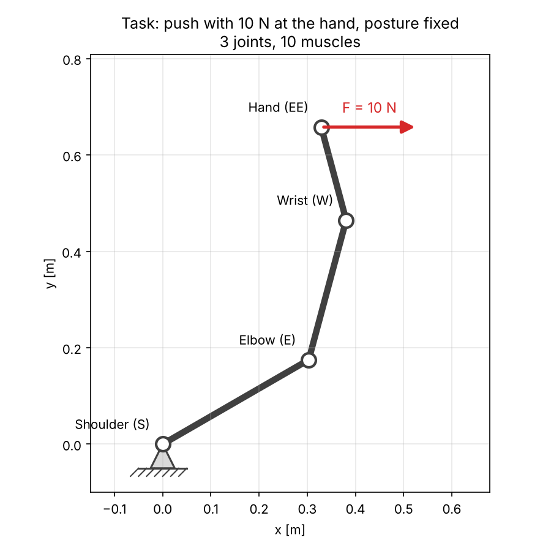</p>

The 10 muscles of the model, as drawn in the paper: shoulder (sf, se), elbow (ef, ee) and wrist (wf, we) mono-articular flexor/extensor pairs, a bi-articular shoulder–elbow pair (bf, be) and a forearm wrist pair (fwf, fwe).

<p align="center">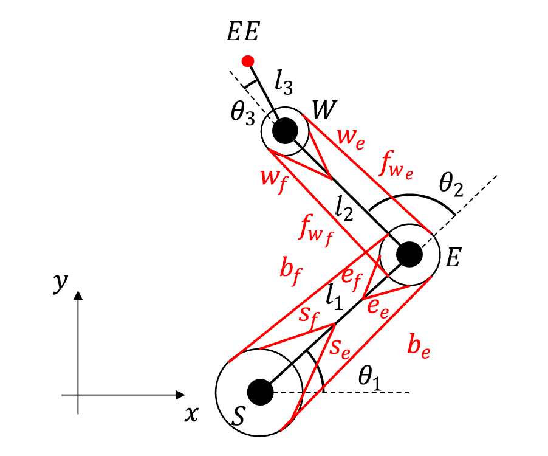</p>

*Fig. 5 from Tessari, West, Hogan, PNAS 2025, reproduced without changes under the CC BY-NC-ND 4.0 license.*

 Since there are more muscles than joints, infinitely many muscle-force combinations produce the same joint torques. A simple trial-and-error learner, started many times from exactly the same initial condition, converges each time to a different but equally effective solution. The paper compares 51 solutions (50 learners plus the minimum-effort solution), far more than the 10 muscles: if each run is seen as a different person learning the same task, different people can end up with different synergies.

## This repository

This is a step-by-step Python replication of the example, written as a learning project and as a base for extensions (synergy expansion, reinforcement learning). It rebuilds kinematics, statics, the muscle model, the random search, the minimum-effort reference solution, and the comparison of the solutions.

## Status

| Stage | Content | Status |
|---|---|---|
| 1 | Kinematics: forward kinematics, analytic and numerical Jacobian, plotting | Done |
| 2 | Statics (τ = Jᵀ F) and Jacobian null space, with animation | Done |
| 3 | Muscle model: muscle Jacobian Jm and muscle forces to joint torques (τ = Jmᵀ Fm) | Done |
| 4 | Random search for muscle forces, 50 runs, replica of Fig. 8 | Done |
| 5 | Minimum-effort solution as a reference (constrained pseudoinverse) | Done |
| 6 | Solution comparison (DIEM), replica of Fig. 9 and Fig. 10 | Done |

## Structure

| File | Content |
|---|---|
| `kinematics.py` | Forward kinematics, 2×3 Jacobian (analytic and numerical), Jacobian null space |
| `muscles.py` | Muscle Jacobian `Jm` (10×3, moment arms) and mapping from muscle forces to joint torques |
| `search.py` | Random search for muscle forces: single run and 50-run experiment, Fig. 8 replica |
| `plotting.py` | Arm configuration plot |
| `test_kinematics.py` | Tests: fixed configurations, 2-link limit case, analytic vs numerical Jacobian, null space (fixed and random configurations) |
| `test_muscles.py` | Tests: single-muscle torques, antagonist pair cancelling out, null space of `Jmᵀ` (dimension 7) |
| `min_effort.py` | Minimum-effort solution: plain pseudoinverse (check) and with forces ≥ 0 (reference); saves `synergies_51.npy` |
| `diem.py` | DIEM between all pairs of the 51 solutions: Fig. 9 (histogram) and Fig. 10 (example pairs) replicas |
| `extension_load.py` | Extension (not in the paper): maximum force per muscle, feasible ranges and DIEM at increasing hand force |
| `synergies.npy` | The 50 muscle-force solutions found by the random search (50×10) |
| `synergies_51.npy` | The 50 solutions plus the minimum-effort solution as last row (51×10), input for the DIEM comparison |
| `fig8_replica.png` | Torque error vs iteration for the 50 runs |
| `make_figures.py` | Generates the figures in `figures/` from `synergies.npy` |
| `figures/` | `task.png`, `solutions.png`, `learning.gif`, `null_space.gif`, `fig9_diem.png`, `fig10_examples.png`, `extension_feasible.png`, `extension_diem_load.png` (generated); `paper_fig5.png`, `paper_fig8.png` (from the paper) |

## Method

The random search follows the description in the paper:

1. Start from all muscle forces at zero.
2. At each iteration, generate 5 candidates by adding a random increment drawn uniformly in [−25, 25] N to each muscle force; negative forces are set to zero.
3. For each candidate, compute the joint torques τ = Jmᵀ Fm and the error e = Σ (τ − τ_required)².
4. Keep the candidate with the smallest error, even if it is worse than the current solution.
5. Stop when e ≤ 0.01.

The experiment is repeated with 50 random seeds.

## Parameters

The paper does not report all the numerical values, so some were chosen or estimated:

- Link lengths: 0.35, 0.30, 0.20 m (estimated from Fig. 7).
- Joint angles: 30°, 45°, 30° (estimated from Fig. 7).
- Required end-effector force: F = [10, 0] N.
- Moment arms: 0.04 m (shoulder), 0.03 m (elbow), 0.02 m (wrist), with signs set by flexor/extensor role. These values are not given in the paper; see the comments in `muscles.py`.

## Results

### Null space of the arm Jacobian

With 3 joints and a 2D hand position, J is 2×3 and has a 1-dimensional null space: the joints can move in one direction without moving the hand.

<p align="center">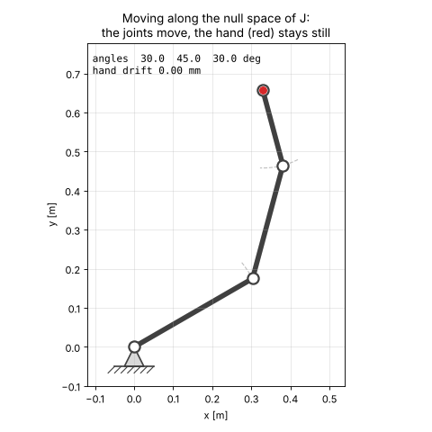</p>

### Random search

Three learners start from the same point (all muscles relaxed) and end on different solutions:

<p align="center">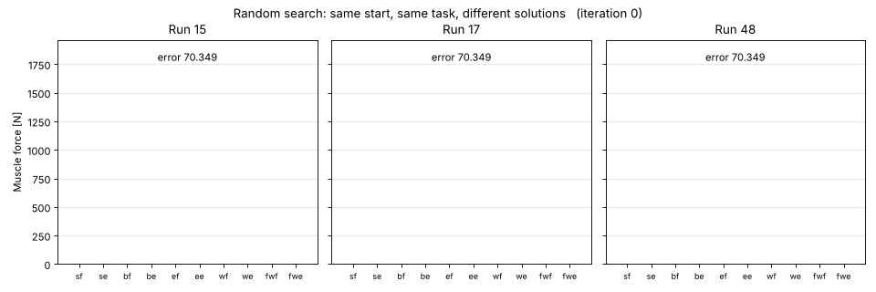</p>

The four most different of the 50 solutions all produce the required joint torques, with very different muscle forces:

<p align="center">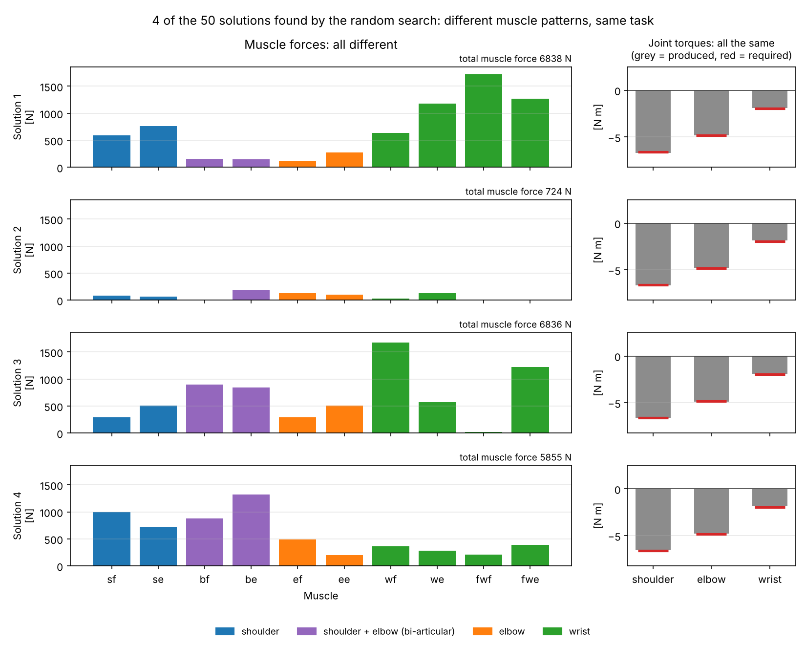</p>

Torque error during learning for all 50 runs (replica of Fig. 8 of the paper):

<p align="center">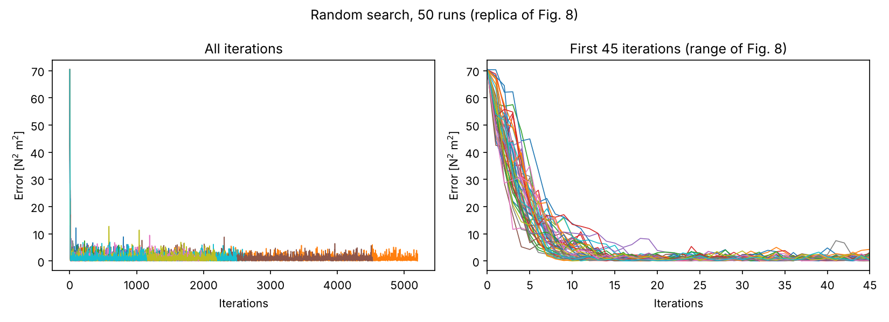</p>

For comparison, the original Fig. 8:

<p align="center">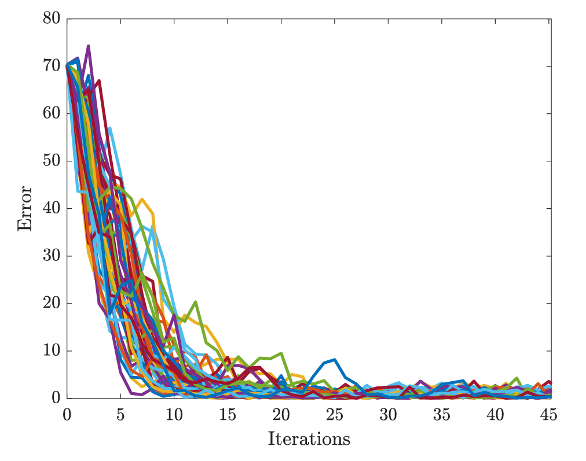</p>

*Fig. 8 from Tessari, West, Hogan, PNAS 2025, reproduced without changes under the CC BY-NC-ND 4.0 license.*

- Initial error: 70.35, consistent with the starting value in Fig. 8 (about 70).
- The first ~10 iterations reproduce Fig. 8 well (error from ≈70 to near zero). Fig. 8 shows the first 45 iterations; reaching the 0.01 threshold, not visible at that scale, takes 32 to 5198 iterations here (median 783).
- All 50 runs reach e ≤ 0.01, each with a different muscle-force solution.
- The solutions differ widely in total muscle force, from about 720 N to about 7400 N (median about 2600 N): the same torques are obtained with very different levels of co-contraction.

### Minimum-effort solution

Among all muscle forces that produce exactly the required torques, the minimum-effort solution minimizes Σ Fm,i². The paper computes it with a constrained Moore–Penrose inverse, so that all forces are positive.

- The plain pseudoinverse gives exact torques but negative forces on all five flexors (muscles that would push): effort ≈ 11,160 N².
- With the constraint Fm ≥ 0 (solved with `scipy.optimize.minimize`, SLSQP), only the five extensors are active and the flexors are relaxed: effort ≈ 22,330 N², torque error ≈ 1e-23. In this posture, pushing the hand in +x requires extension torques at all three joints.

### Comparison of the solutions (DIEM)

How similar are the 51 solutions (50 learners plus the minimum-effort one)? The paper measures it with the DIEM (Dimension-Insensitive Euclidean Metric; Tessari, Yao, Hogan, 2024). For each of the 51·50/2 = 1275 pairs, the Euclidean distance between the two force vectors is compared with the distance between random vectors with the same number of components and range: 0 means as far apart as two random vectors, negative more similar, positive more different. Center and spread of the random distances are estimated by simulation, as in the [official code](https://github.com/ftessari23/DIEM).

<p align="center">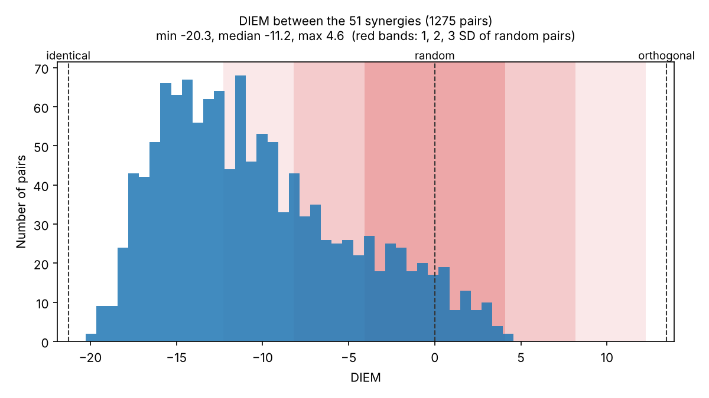</p>

- Min −20.3, median −11.2, max +4.6 (paper: −20.52, mode −12.50, +6.09).
- No pair is identical, and the solutions range from nearly identical to more different than random pairs, as in the paper.

<p align="center">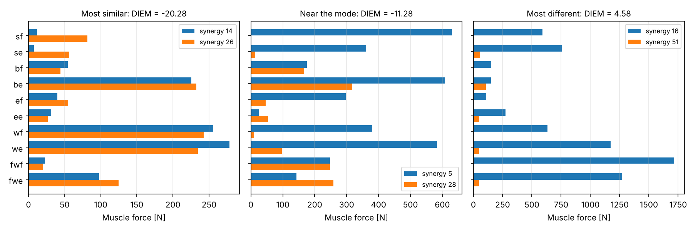</p>

The most different pair is a solution with strong co-contraction against the minimum-effort solution.

**Range of the random vectors.** The paper does not report the range used for the random reference. Here forces are divided by the largest muscle force among the 51 solutions (1717 N), so all components are in [0, 1]. The pairwise values depend on this choice: with the 95th or 90th percentile of the forces instead of the maximum, the median DIEM moves from −11.2 to −1.2 or +3.4, and the share of pairs more similar than random from 94% to 55% or 40%. The range of values and the existence of many distinct solutions do not depend on it.

## Difference from the paper

This replica follows the method described in the paper, but some modelling details (for example the muscle moment arms) are not part of the published description and had to be chosen here. One result comes out differently: in the paper about 31% of the selectable synergies (+x direction, SI Appendix) need less effort than the minimum-effort solution, thanks to the allowed torque error. Here none of the 50 does (the lightest needs about 3.5 times the reference effort).

Two observations help to read this difference:

- **How much the tolerance allows.** Accepting a torque error up to 0.01 lowers the smallest possible effort by only ≈ 3% (from ≈ 22,330 to ≈ 21,680 N²). A solution lighter than the exact minimum must therefore be almost free of co-contraction, while a search that adds random increments to all ten muscles at every step tends to accumulate some.
- **How the reference is computed.** Among the infinitely many force vectors that produce the torques exactly, the effort is minimal for only one. A method that minimizes the torque error under Fm ≥ 0, without the effort in the objective, can return any of the exact solutions, including heavier ones, and then more good-enough solutions would be lighter than the reference. Here the reference is computed by minimizing the effort explicitly.

The main result does not change: many different, equally effective solutions to the same task.

## Extension: synergies under load

The paper notes that adding constraints to a motor task shrinks the space of selectable synergies: for example, a larger task space (more points of contact, as in the game of Twister) reduces the null space, down to a single obligatory synergy. This section looks at one more constraint that the numerical example does not include: a maximum force per muscle (300 N here, a hypothetical value, equal for all muscles), at increasing levels of the required hand force.

**The space of solutions shrinks.** The range of forces each muscle can take while still performing the task narrows as the required hand force grows, in line with results on muscle redundancy (Kutch and Valero-Cuevas). At 10 N every muscle is free over its whole range; at the maximum hand force (≈ 36.5 N) the shoulder and bi-articular muscles have a single possible value, while the wrist muscles keep some freedom.

<p align="center">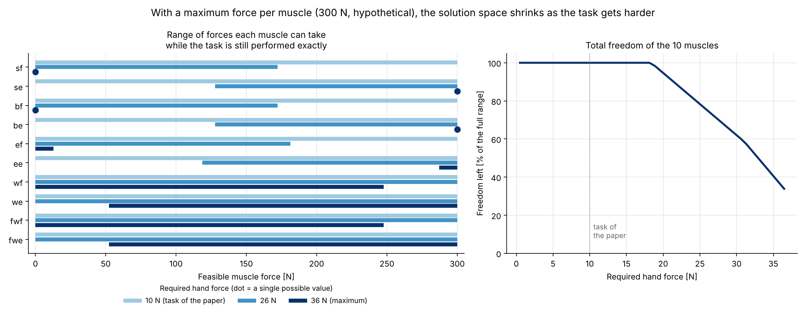</p>

**The solutions become more similar.** The random search was repeated (50 runs) at six hand force levels between 5 and 36 N, and the DIEM was computed between all pairs at each level.

<p align="center">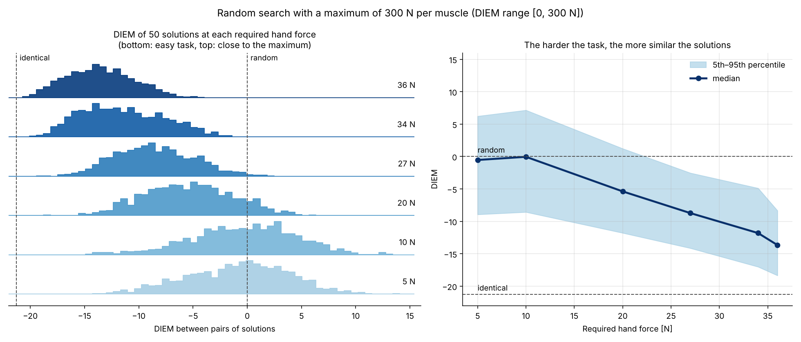</p>

- Up to 10 N the distribution is centered near 0 (median −0.5 at 5 N, 0.0 at 10 N): solutions are about as different from each other as random vectors.
- From 20 N the distribution moves toward "identical", and from 34 N no pair is more different than two random vectors (median −11.8, maximum −1.9).

Two remarks:

- **A physical reference for the DIEM.** The DIEM is designed for bounded quantities. With a maximum force per muscle, the range of the random reference is the physical range of each muscle, and the calibrated zero turns the trend into a direct statement: from 34 N on, even the two most different solutions are more similar than two random vectors.
- **Diversity depends on the task.** The DIEM stays roughly flat while the task is far from the muscle limits, and drops only close to the maximum. The task of the paper (10 N) lies in the flat region, where many different synergies are available. Close to the limits of the muscles, the choice narrows.

These results come from a simplified setting: one hypothetical maximum force for all muscles, one direction of force, 50 runs per level. The values at 10 N are not comparable with the main replica, because the force limit changes both the solutions and the DIEM reference.

## Conventions

- Angles in radians, relative: each joint angle is measured from the previous link.
- Shoulder at the origin. Points: `shoulder`, `elbow`, `wrist`, `end_effector` (S, E, W, EE in the paper).
- Forces in N, lengths in m, torques in N·m.

## Usage

Requires Python 3.12.

```bash
python3 -m venv .venv
source .venv/bin/activate
pip install -r requirements.txt

# tests
python test_kinematics.py
python test_muscles.py

# random search: 50 runs, saves synergies.npy and fig8_replica.png
python search.py

# minimum-effort solution, saves synergies_51.npy
python min_effort.py

# DIEM comparison, saves fig9_diem.png and fig10_examples.png in figures/
python diem.py

# README figures: saves task.png, solutions.png, learning.gif and null_space.gif in figures/
python make_figures.py

# extension: saves extension_feasible.png and extension_diem_load.png in figures/
python extension_load.py
```

## Credits

Paper figures (`figures/paper_fig5.png`, `figures/paper_fig8.png`): F. Tessari, A. M. West Jr., N. Hogan, *PNAS* 122, e2501705122 (2025), distributed under the [CC BY-NC-ND 4.0](https://creativecommons.org/licenses/by-nc-nd/4.0/) license and reproduced here unmodified. All other code and figures are original to this repository.
