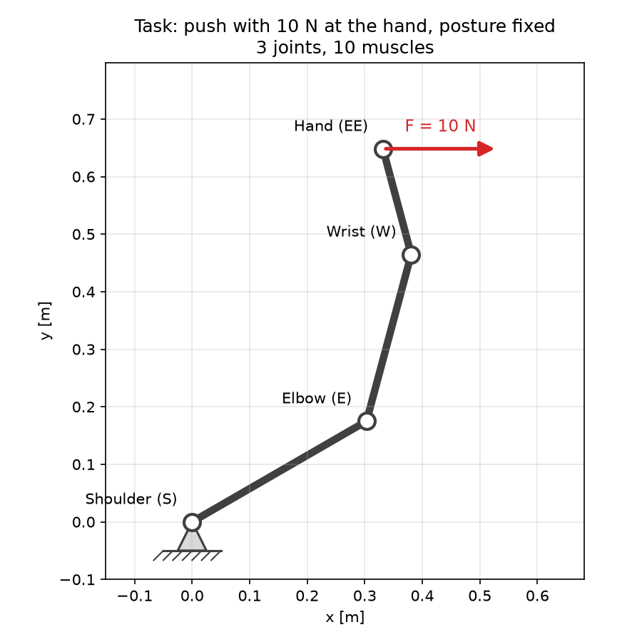
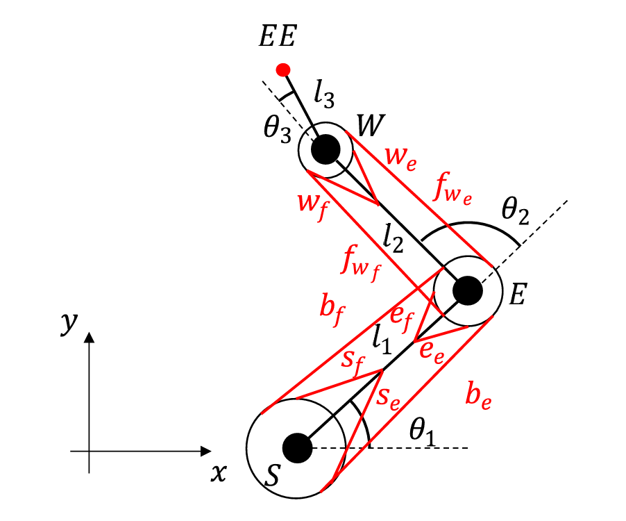
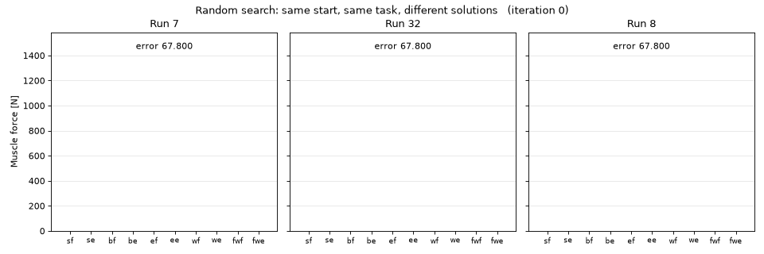
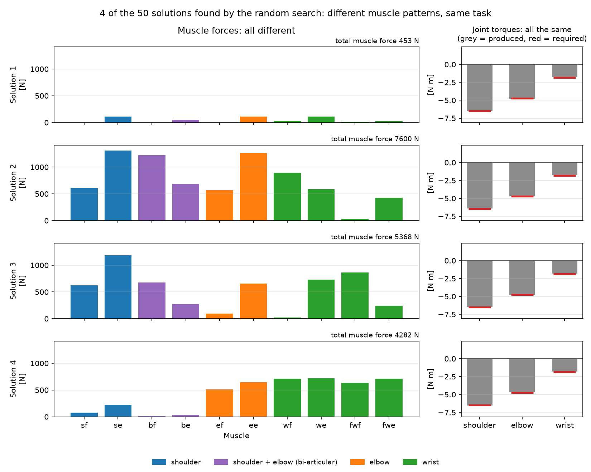
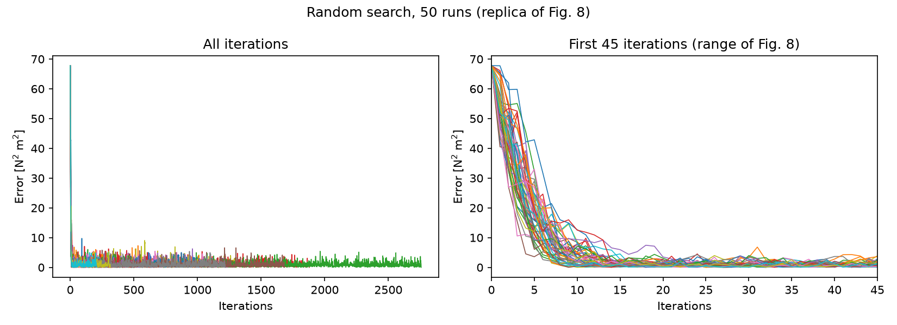
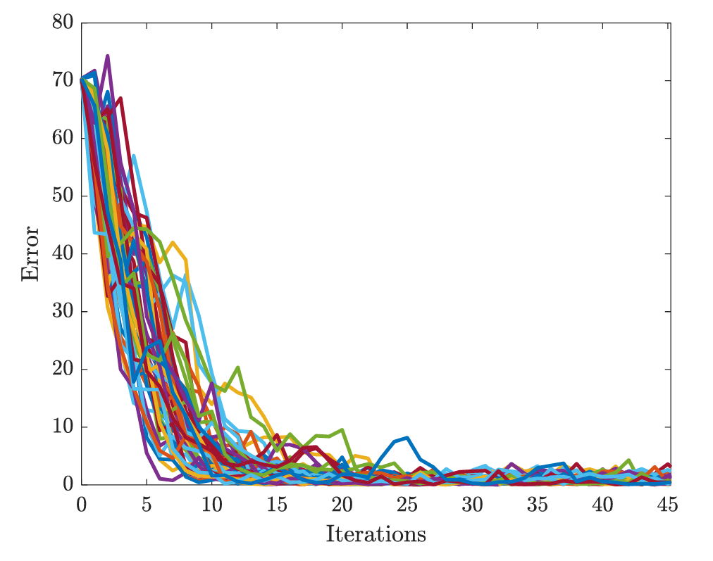

# Synergy Expansion — Numerical Example Replication

Python replication of the numerical example in:

> F. Tessari, A. M. West Jr., N. Hogan, "Explaining human motor coordination via the synergy expansion hypothesis," *PNAS* 122, e2501705122 (2025). https://doi.org/10.1073/pnas.2501705122

## Context

The human body has far more muscles and joints than any single task requires, so the same movement or force can be produced in infinitely many ways. How the nervous system chooses among them is Bernstein's degrees-of-freedom problem. A classic answer is that it does not control each muscle independently, but a small number of *synergies*: groups of muscles activated together.

The paper proposes the *synergy expansion hypothesis*, built on three propositions:

- **Mechanical:** because the body is redundant, the number of possible synergies is not limited by the number of muscles or joints.
- **Developmental:** humans start from crude, highly coordinated patterns (primordial synergies) and, through learning and development, expand to new and more specialized synergies, which add to the old ones instead of replacing them.
- **Behavioral:** learned synergies are stored and recalled when needed.

The numerical example makes the first two propositions concrete. A planar 3-link arm (upper arm, forearm, hand) actuated by 10 muscles must produce a given force at the hand in a fixed posture.

<p align="center"></p>

The 10 muscles of the model, as drawn in the paper: shoulder (sf, se), elbow (ef, ee) and wrist (wf, we) mono-articular flexor/extensor pairs, a bi-articular shoulder–elbow pair (bf, be) and a forearm wrist pair (fwf, fwe).

<p align="center"></p>

*Fig. 5 from Tessari, West, Hogan, PNAS 2025, reproduced without changes under the CC BY-NC-ND 4.0 license.*

 Since there are more muscles than joints, infinitely many muscle-force combinations produce the same joint torques. A simple trial-and-error learner, started many times from exactly the same initial condition, converges each time to a different but equally effective solution. The paper obtains 51 distinct solutions, far more than the 10 muscles: if each run is seen as a different person learning the same task, different people can end up with different synergies.

## This repository

This is a step-by-step Python replication of the example, written as a learning project and as a base for extensions (synergy expansion, reinforcement learning). It rebuilds kinematics, statics, the muscle model, the random search, and the comparison of the solutions. This replica runs 50 learners instead of 51.

## Status

| Stage | Content | Status |
|---|---|---|
| 1 | Kinematics: forward kinematics, analytic and numerical Jacobian, plotting | Done |
| 2 | Statics (τ = Jᵀ F) and Jacobian null space | Done |
| 3 | Muscle model: muscle Jacobian Jm and muscle forces to joint torques (τ = Jmᵀ Fm) | Done |
| 4 | Random search for muscle forces, 50 runs, replica of Fig. 8 | Done |
| 5 | Solution comparison (DIEM) | In progress |
| 6 | Minimum-effort solution as a reference | Planned |

## Structure

| File | Content |
|---|---|
| `kinematics.py` | Forward kinematics, 2×3 Jacobian (analytic and numerical), Jacobian null space |
| `muscles.py` | Muscle Jacobian `Jm` (10×3, moment arms) and mapping from muscle forces to joint torques |
| `search.py` | Random search for muscle forces: single run and 50-run experiment, Fig. 8 replica |
| `plotting.py` | Arm configuration plot |
| `test_kinematics.py` | Tests: fixed configurations, 2-link limit case, analytic vs numerical Jacobian, null space (fixed and random configurations) |
| `test_muscles.py` | Tests: single-muscle torques, antagonist pair cancelling out, null space of `Jmᵀ` (dimension 7) |
| `synergies.npy` | The 50 muscle-force solutions found by the random search (50×10) |
| `fig8_replica.png` | Torque error vs iteration for the 50 runs |
| `make_figures.py` | Generates the figures in `figures/` from `synergies.npy` |
| `figures/` | `task.png`, `solutions.png`, `learning.gif` (generated); `paper_fig5.png`, `paper_fig8.png` (from the paper) |

## Method

The random search follows the description in the paper:

1. Start from all muscle forces at zero.
2. At each iteration, generate 5 candidates by adding a random increment drawn uniformly in [−25, 25] N to each muscle force; negative forces are set to zero.
3. For each candidate, compute the joint torques τ = Jmᵀ Fm and the error e = Σ (τ − τ_required)².
4. Keep the candidate with the smallest error, even if it is worse than the current solution.
5. Stop when e ≤ 0.01.

The experiment is repeated with 50 random seeds.

## Parameters

The paper does not report all the numerical values, so some were chosen or estimated:

- Link lengths: 0.35, 0.30, 0.19 m (estimated from Fig. 7).
- Joint angles: 30°, 45°, 30° (estimated from Fig. 7).
- Required end-effector force: F = [10, 0] N.
- Moment arms: 0.04 m (shoulder), 0.03 m (elbow), 0.02 m (wrist), with signs set by flexor/extensor role. These values are not given in the paper; see the comments in `muscles.py`.

## Results and discrepancy with the paper

Three learners start from the same point (all muscles relaxed) and end on different solutions:

<p align="center"></p>

The four most different of the 50 solutions all produce the required joint torques, with very different muscle forces:

<p align="center"></p>

Torque error during learning for all 50 runs (replica of Fig. 8 of the paper):

<p align="center"></p>

For comparison, the original Fig. 8:

<p align="center"></p>

*Fig. 8 from Tessari, West, Hogan, PNAS 2025, reproduced without changes under the CC BY-NC-ND 4.0 license.*

- Initial error: 67.80, consistent with the starting value in Fig. 8 (about 70).
- All 50 runs reach e ≤ 0.01, each with a different muscle-force solution.
- The solutions differ widely in total muscle force, from about 450 N to about 7600 N (median about 2000 N): the same torques are obtained with very different levels of co-contraction.
- The first ~10 iterations reproduce Fig. 8 well (error from ≈70 to near zero).
- Reaching the 0.01 threshold takes 18 to 2758 iterations (median 486), against 10–45 in the paper. The most likely cause is the difference in the unpublished parameters (moment arms in particular).

## Conventions

- Angles in radians, relative: each joint angle is measured from the previous link.
- Shoulder at the origin. Points: `shoulder`, `elbow`, `wrist`, `end_effector` (S, E, W, EE in the paper).
- Forces in N, lengths in m, torques in N·m.

## Usage

Requires Python 3.12.

```bash
python3 -m venv .venv
source .venv/bin/activate
pip install -r requirements.txt

# tests
python test_kinematics.py
python test_muscles.py

# random search: 50 runs, saves synergies.npy and fig8_replica.png
python search.py

# README figures: saves task.png, solutions.png and learning.gif in figures/
python make_figures.py
```

## Credits

Paper figures (`figures/paper_fig5.png`, `figures/paper_fig8.png`): F. Tessari, A. M. West Jr., N. Hogan, *PNAS* 122, e2501705122 (2025), distributed under the [CC BY-NC-ND 4.0](https://creativecommons.org/licenses/by-nc-nd/4.0/) license and reproduced here unmodified. All other code and figures are original to this repository.
